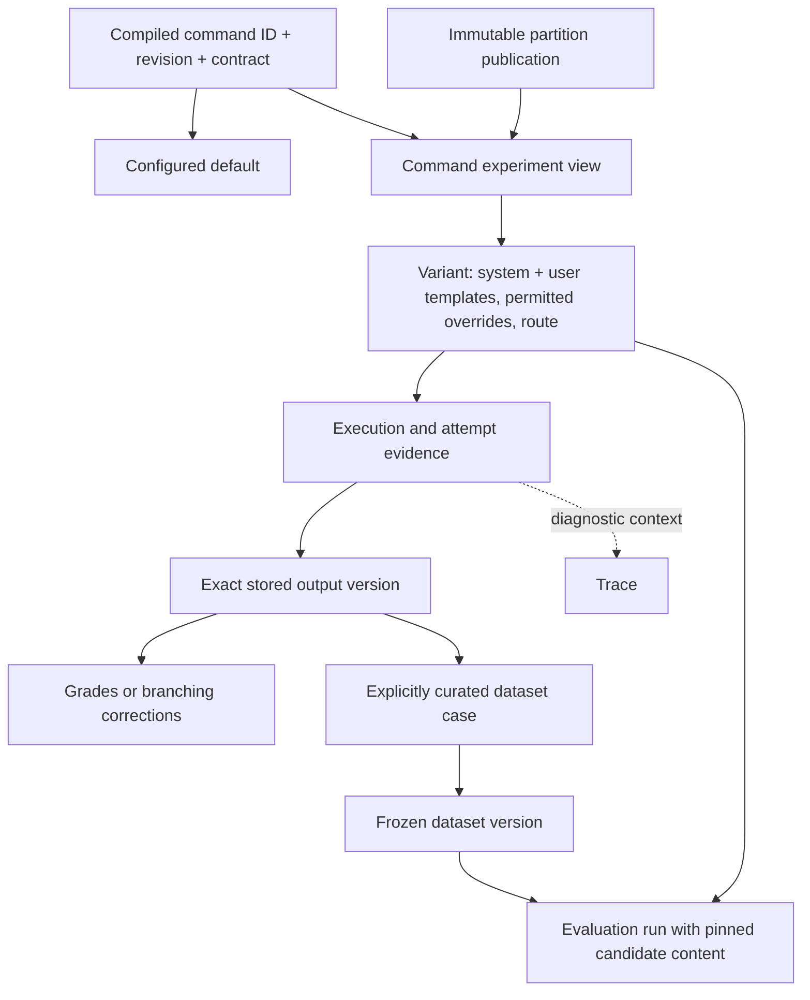
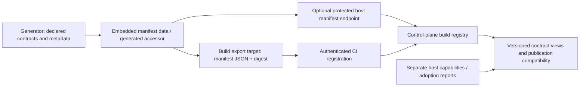

# AgentCmd console: screens and workflows

Design reference, 2026-11-05. The [repository README](../../../README.md#management-console) describes the implemented API/client and its current limits. Statements below about source availability describe the original design baseline. The screen images use synthetic data; they are visual references, not measured results or proof that every proposed capability exists.

## Direction

Use a compact desktop workspace built with Vue, Nuxt UI on Vite, and a .NET management backend. Use a contract-first OpenAPI and Kubb integration. Keep the AgentCmd runtime and its provider-neutral interfaces independent of the console.

Primary navigation is **Commands · Experiments · Traces · Datasets · Review**. Variants, publications, evaluation runs, and exact outputs are detail views within those work areas. Each view retains the selected partition and preserves filters when the user drills into an output or returns from a trace.

The initial working loop is: select a registered command, create a draft publication, preview templates, evaluate on frozen cases, inspect disagreements, and review publication impact. Production monitoring supplements that loop. It currently supports descriptive reporting, not a causal winner claim.

## How prompts and experiments link

Prompt text belongs to a variant in a publication. A separate mutable Prompt entity would create another version that could drift from the route, parameters, or observed output. Reuse starts with **Copy from variant at publication**, producing a draft with provenance.

A publication is an atomic snapshot for a partition. A command-scoped editor must show that wider scope. The final review names every affected command and compares the proposed publication with its base. Publishing never edits historical content. Evaluations against a draft pin its content hash; a later edit displays **Draft changed since this run**.

Both message templates render from the same typed input. `SystemTemplate` is optional; its override can inherit, replace, or remove the system message. `UserTemplate` is required and must render nonblank. Placeholders use single braces, such as `{Document}`. Only command-declared runtime-overridable parameters and host-authorized routes/settings are editable. Input and output contracts remain read-only.

## Density and interaction rules

Use approximately 13px body text, 11–12px metadata, 28–32px table rows, 24–28px icon controls, 12–16px gutters, and a 190px sidebar. Use compact card padding and small buttons. These values are implementation targets; generated images are visual references, not pixel specifications.

Repeated secondary actions use ghost icon buttons: inspect, copy exact reference, view publication, or open trace. Each icon has an accessible name and a keyboard-accessible tooltip. Use a popover for contextual details or multiple related actions. Primary and consequential actions keep labels: **Evaluate on dataset**, **Review publication**, **Publish dataset version**, **Submit grades to this version**, and **View outputs**.

Unknown usage, missing prices, pending grades, unavailable evidence, and a real score of zero have distinct states. Do not use color as their only distinction. Keep dense tables readable with explicit units and short headings. Loading, empty, failed, partial, and access-denied views belong to each workflow.

Use progressive disclosure to reduce metadata clutter. Each detail view keeps its primary artifact, exact selected identity, important failure/availability state, and main action visible. Use tabs to switch tasks; use accordions for secondary sections within a task; use tooltips/popovers for short contextual metadata. Show the selected tab/expanded state in deep links and preserve it on return navigation.

- Output inspector: **Output & grade** is the default task. **Evidence** and **Lineage** are separate tabs. Keep the viewed `VersionId`, producer kind, and exact grade target visible. Put the full branching version tree behind an expandable **Versions (4)** section, with the selected branch summarized when closed. Compositions keep the aggregate identity visible.
- Dataset case: **Case** and **Evaluation history** are tabs. Input and reference are the main case content. Reference source metadata has a compact summary with an inspect/provenance popover. Notes and unused input fields can collapse. Draft reference changes retain explicit Inspect and Save actions.
- Trace: the waterfall and selected attempt outcome are primary. Use **Attempt details**, **Related outputs**, and **Raw attributes** tabs. Within attempt details, keep kind, requested/served route, failure, timing, and partial cost visible; collapse the full settings/identifier map. Related shadows have an expandable summary rather than a large permanent card.
- Evaluation: keep dataset/candidate pins and coverage visible. Collapse the full configuration/rubric metadata; the paired-case table gets the space. Draft editor: templates and render preview remain primary, while advanced route settings and optional override details can collapse.

Do not hide an unresolved failure, an unsaved reference change, a mismatched contract, or partial accounting behind a disclosure control. Essential identity stays visible even when its full metadata is collapsed.

## Screen set

| Screen | Main task | Actions and boundaries |
| --- | --- | --- |
| [1. Command workspace](mockups/01-command-workspace-v2.png) | Find a contract, publication, or draft | View immutable publication; open experiment; create draft; open evaluation setup. Show whole-partition scope and a read-only contract rail. A command using its configured default needs no experiment publication. |
| [2. Draft publication editor](mockups/02-draft-publication-v3.png) | Edit templates and permitted settings | Save draft; validate; preview rendered input; open evaluation setup; review publication. Validation and rendering make no model calls. The final publish action belongs to impact review. |
| [3. Production monitor](mockups/03-production-monitor-v3.png) | Track quality by input cohort and time | Choose criterion, contract, publication, and time window; inspect cases; view fallback traces; open shadow pairs; review rollout. Show configured allocation separately from observed executions. |
| [4. Matched evaluation](mockups/04-matched-evaluation-v3.png) | Compare same-contract candidates on fixed cases | Pin dataset version, candidate content, and rubric; inspect matched and incomplete pairs; open exact outputs. Show per-candidate completion, storage, grading, and failure counts. |
| [5. Output inspector and Review](mockups/05-output-review-v4.png) | Grade or correct an exact stored version | View original or correction branch; grade whole or field; save a correction; add to a dataset draft; open trace. Composition inspection starts with the exact stored aggregate. |
| [6. Dataset and case inspector](mockups/06-dataset-explorer-v4.png) | Curate reusable regression cases | Edit the draft; choose input and reference with provenance; validate case; publish dataset version. Frozen versions remain read-only. References are selected in case context. |
| [7. Traces](mockups/07-traces-v3.png) | Diagnose latency, retries, fallback, or missing telemetry | Select execution/span; inspect attempt evidence; view related exact outputs; open external telemetry; inspect related shadows. Trace status and execution status are independent. |
| [8. Cross-contract study](mockups/08-cross-contract-study-v3.png) | Compare different output shapes | Choose a stored evaluation run and variant per arm, shared dataset, and versioned task criteria. Inspect raw shapes and human criterion grades. Do not model schema changes as variants of one command contract. |
| [9. System settings](mockups/09-system-settings-v2.png) | Configure publication-store connectivity | Manage provider-aware connection profiles, partition bindings, capability checks, and activation review. Put this behind a secondary Settings gear. Keep read tests, profile saves, publication writes, and host adoption separate. |

The `mockups` folder contains the selected image set. The [generation manifest](generation-manifest.json) records the actual prompts and image sources. The [review](review.json) records the bounded team verdicts and visual limits. The expert's screen notes are retained as supporting design input.

## Workflows and actions

### Author, evaluate, and publish

1. Select a registered command and its compiled revision. An empty registry offers an application registration guide; it does not offer a misleading Create command action.
2. Create a draft from the configured default or a named publication. Edit the variant's templates, allowed parameters, and route.
3. Validate against the contract and current route policy. Preview rendering against sample inputs. Sample validation is evidence about those inputs, not a guarantee for every future input.
4. Open evaluation setup. Select a frozen dataset version, pinned candidates, criterion/rubric version, and eligible cases.
5. Review the planned generation and evaluator calls, retries, any requested shadows, permitted routes, limits, and estimate coverage. **Start evaluation** is the explicit paid action. Saving, validating, and rendering do not start it.
6. Inspect paired results and unresolved cases. Keep failed, unavailable, and ungraded outcomes visible.
7. Review publication impact: partition, base revision, every affected command, before/after content, allocation or shadow settings, and route authorization. **Publish revision** creates a new immutable snapshot.

Publishing and observed adoption are separate states. Caches and pinned compositions can continue to use earlier content. Stop or restore is a new host-controlled publication or explicit selector policy. Setting every weight to zero is not a reliable stop with current selector behavior. A publication change does not cancel work already pinned or in flight.

### Diagnose and review

From an experiment cohort, open an exact case/output, then its trace or attempt timeline. Back navigation retains the time window, cohort, criterion, and exact output version. A trace can link to zero, one, or many outputs. A span is never a grade target.

Show execution outcome, storage delivery, composition sealing, and grading as separate statuses. A successful execution does not prove an output was stored. A failed execution can still have retained spans. A composition's aggregate is the whole to grade; component lineage is secondary context.

A correction creates another output version with its own `VersionId` and parent. Siblings can have the same numeric version. The inspector distinguishes the model's original returned output from the human correction being viewed. Saving a correction neither changes the production result nor selects a dataset reference.

Screen 5's human-correction grading is an ad-hoc review example. Benchmark model comparison instead targets the pinned original model output or exact sealed aggregate. A human correction can become a dataset reference only through adjudication; it does not retroactively improve a model's benchmark score.

### Curate a dataset

A dataset is proposed as a versioned collection of frozen cases. A live query over captured outputs is a discovery source, not a reproducible evaluation dataset. The curator explicitly selects retained input and an authored or adjudicated reference, records provenance, tags input cohorts, and freezes a dataset version.

Reference adjudication names the exact correction branch or authored value, adjudicator, time, and rationale. Another correction can be shown as a hint; it never changes the frozen reference. Removing a case from a draft leaves historical evaluations intact. Grades and references are separate records.

### Compare output shapes

A cross-contract study selects **evaluation run + variant + build/command revision** per arm. One run can contain multiple variants, so the run ID alone is insufficient. Each arm retains publication or draft content identity.

The same frozen case population is required. The current combined `ContractSignature` cannot independently verify identical input shape. Until separate input/output signatures exist, show **Input shape declared identical by [reviewer]** or **Unverified**, with explicit engineering review. Do not show an automatic verified gate. Different input shapes need a named, versioned adapter before execution can be compared.

Use versioned task criteria, for example Total amount correct. Show each arm's relevant location, such as `/total` in revision 7 and `/Totals/Amount` in revision 8. Human criterion grading can compare the task result directly. Scoped semantic judges and incomplete-reference handling are now specified in [Semantic judges and incomplete references](semantic-judging.md); the judge runner, automated mapping implementation, and input adapters are not implemented. Do not pool arbitrary field scores across schemas.

The runs come from the builds that contain those compiled contracts. The console compares their stored outputs; it does not imply one runtime can execute two compiled revisions of the same command side by side.

## Performance over time

Field selection and scoring policy are specified in [Benchmarks and primary metrics](benchmarks.md). A benchmark explicitly selects criteria and one primary metric; the manifest supplies structure, not business priority. New/unselected fields remain unscored while full structural validation still applies. Freeze dataset, rubric/evaluator, bindings, aggregation, guardrails, and missing-data policies before launch. Add a Benchmarks tab in the command workspace, with dataset, experiment, and evaluation links; the nine existing mockups do not yet render this extension.

Reference agreement and source-grounded validity are distinct metrics. A partial reference may omit valid discoveries, so unmatched additions are classified by evidence and task relevance rather than automatically counted as errors. Confirmed reference changes create new dataset/benchmark versions and reassessment across compared candidate configurations; original reports stay intact. Semantic-review and reference-gap flows extend the existing case/criterion views rather than adding navigation areas.

Surface benchmark results on each exact variant configuration, its publication/draft history, experiment comparisons, and exact-output grading. **Compare variants** and **Compare selected versions** share the pinned candidate/benchmark model. Keep benchmark/dataset/evaluator context, Primary, guardrails, coverage, and evidence freshness visible. A changed configuration never silently inherits its predecessor's score. See the [variant and version comparison requirements](benchmarks.md#variant-and-version-comparisons).

Every report keeps a comparison frame: mode; command revision/contract; publication or draft hash; dataset version or input cohort; time window; criterion/rubric version; and grades-as-of time.

Show valid-output/success rates over eligible attempts separately from mean quality over graded stored outputs. Show graded/eligible coverage beside scores. Missing grades are not zero. Failed or schema-invalid outcomes stay in eligible denominators even when no gradeable artifact exists. Late grades update earlier output-time buckets; an as-of cutoff makes that change visible.

Production cohorts use attributes known before execution, such as input tags, locale, or input-size bucket. Filters based on the result, such as currency missing, are diagnostic subsets. They must not silently change population performance estimates.

Production reporting is **Descriptive — what actually ran** until intended assignment is captured. Current fallback evidence can omit experiment and variant identity. `InvalidRelease` can occur before or after selection, so absent identity does not prove the execution was unassigned.

Keep default executions outside the observed arms:

- Established pre-selection failure: **Not in experiment**.
- Selector default/failure/unknown variant: separate selector rows.
- Ambiguous `InvalidRelease`: **Ran configured default — assignment unknown**.

Provider route fallback is a separate dimension. Shadow outputs are not caller exposures. Show offered, accepted, dropped, failed, and stored from scheduler/ledger records. Missing spans are not shadow accounting.

Split time series at publication/allocation changes. Show estimated cost per priced run, priced/total coverage, unpriced counts, and price provenance. Estimates are not billed amounts. Unknown cost is never free.

## Traces and authority

Stored output identity, execution/attempt evidence, and a complete authoritative journal drive outcomes and accounting. Traces provide diagnostic timing and context. A trace anchor carries identifiers and sampling context; it proves neither retained spans nor access to them.

Trace availability has explicit states: not captured, not found, partial, available, backend unavailable, and no access. Show confirmed sampling or retention expiration only when the backend establishes that reason. Otherwise show availability unknown. Run access and trace-backend access are both required before content is exposed.

The proposed trace workspace contains an evidence-driven attempt timeline and an optional retained span view. A complete in-console waterfall requires a trace query adapter and retained telemetry. **Open telemetry backend** is the fallback for hosts that provide only deep links. Source, selector, and route spans in the concept image are proposed instrumentation; do not infer that all exist today.

Use `AttemptId` to count each stored attempt once. Nested MEAI `gen_ai` spans, tool loops, composition parents, and external sink totals must not be added again. Null tokens/prices stay unknown. Show root elapsed time separately from concurrent span durations. If trace data conflicts with evidence, show the evidence and a Trace differs indicator.

A journal start without completion means spend is uncertain. Absence of entries proves no send only when the journal is complete, authoritative, and covers the execution path. In-memory data lost after restart cannot prove that. With missing journal evidence, show Send status unknown.

Related primary/shadow executions join through comparison-group evidence. Their actual trace parentage is not guaranteed by current code. Keep related traces in a separate group; do not invent a child or root relationship. Feedback events can have their own traces. Prompt/output text stays behind the output inspector's capture and access rules.

## Existing seams and proposed host capabilities

The library already supplies typed command contracts, configured defaults, immutable experiment snapshots, source/selector resolution, composition pins, attempt/evidence records, exact output references, grades, corrections, and optional trace anchors. Current defaults use in-memory stores. The file experiment source serves current content; it is not a publication-history store.

The console needs host capabilities that do not exist as a management product today: a compiled-command registry/read model; durable queryable outputs and execution data; draft/publication history; versioned datasets and references; evaluation orchestration; rubric/evaluator identity; metric/cost aggregation; review queries; and management authorization. A retained trace query adapter is optional. These are product requirements, not an endpoint, database, or implementation task decomposition.

Two evidence additions are needed before stronger analytics: preserve intended experiment/variant/publication/unit and fallback stage; expose separate input and output signatures. Failed executions also need reliable execution/attempt trace correlation if they are to appear without a stored output anchor.

## Stack reference and component fit

The Vue application uses `@nuxt/ui/vite` and `@nuxt/ui/vue-plugin`. Kubb consumes exported .NET OpenAPI and generates TypeScript models plus fetch clients. Keep that contract-first direction and the current AgentCmd SDK target. Deployment base URLs must be configurable rather than copying a hard-coded localhost URL.

Nuxt UI provides dashboard panels/sidebar/search, tables, forms, tabs, badges, steppers, tree/accordion views, overlays, tooltips, and popovers. Use compact component variants instead of replacing the component system. Template editing should preserve plain text and placeholder syntax.

The current [Nuxt UI component index](https://ui.nuxt.com/llms.txt) includes `UChart`; its [chart documentation](https://ui.nuxt.com/docs/components/chart) describes the TanStack Charts peer dependency. Verify support with the selected Nuxt UI version in plain Vue/Vite before relying on it. The trace waterfall is a separate custom timing view, not a claim about `UChart`.

## Command discovery: build manifests

This console needs an authoritative command manifest for schema-aware editing, dataset compatibility, placeholder completion, override forms, and publication review. Passive raw-output inspection can work without one. Inferring shapes from captured payloads or outputs is useful for discovery and input cohorts, but it is not a command contract: omitted/null fields, serializer names, override permissions, and commands that never ran would be missed.

### What the command library exposes today

- A generated `IGeneratedCommandCatalog` lists command ID, revision, CLR input/result/command types, and default profile. This registration table is not a portable schema manifest.
- `PromptDescriptor<TP, TR>` owns compiled baseline templates, definition hash, result schema, serializer contract, render/validation delegates, and runtime binding.
- Every current generated descriptor receives a runtime binding and combined contract signature. A manually authored descriptor can omit that optional binding. No overridable fields does not prevent a template-only experiment.
- The generator knows placeholder properties and override permission/type information, but it does not expose them as a serializable catalog table. There is no input-schema export, split input/output signatures, build-manifest artifact, registration endpoint, or host manifest endpoint today.

These are reusable seams, not an existing control-plane integration. Do not derive the override allow-list from all public input properties, or from properties observed in one exported run.

### Recommended publication path for command metadata

Generate the manifest data alongside the command code, and use a build/export target to materialize a portable JSON artifact. Keep the Roslyn generator deterministic: it emits generated source/data through supported generator APIs, not arbitrary filesystem writes. The artifact can be included in the build/package or served by a generated host accessor. Avoid assembly scanning or instantiating command classes to discover types. An export mode must not start providers, execution, containers, or normal application work.

Use **Register build manifest** as the metadata action. Use **Publish configuration** for runtime prompt/parameter/experiment changes. Registering a build does not deploy it, make it active, or send a model request.

CI push is the default transport because it preserves reviewable artifacts and works with private hosts. A protected read-only HTTP endpoint is a useful optional transport for a running application. Both deliver the same manifest representation for the same catalog/build; do not maintain a second HTTP-only schema implementation. File import can register that same authenticated/approved artifact when CI is unavailable.

An HTTP manifest endpoint is opt-in, host-authorized, namespace-scoped, and read-only. It exposes definitions, not user inputs, outputs, credentials, or execution controls. The control plane only pulls from approved application endpoints and identities. A digest identifies content and detects drift; it does not authenticate the publisher. Registration requires an authorized CI/host/operator identity for the application's namespace. An existing immutable build identity with different content returns Conflict rather than silently replacing its schemas.

### Manifest contents and authority limits

Include a manifest format version, application/catalog identity, build/source identity and provenance, content digest, and per-command metadata:

- Stable command ID/revision, definition hash, existing contract signature, and proposed separate serializer-aware input/output signatures.
- Input/output schemas, serialized names, required/nullability rules, and schema support/verification status.
- Placeholder CLR names mapped to serialized properties and supported invariant scalar rendering; override allow-list, types, and constraints.
- Template and parameter-override capabilities separately. A template-only command must not be marked wholly unusable because it has no field overrides.
- Baseline templates/default profile when the host authorizes their disclosure. A profile name is metadata; credentials and resolved secrets are not.
- Composition definitions and slot/member relationships, where generated metadata supports them.
- Presence of custom validation hooks and explicit unsupported/opaque-contract reasons.

Use the same serializer policy as command execution. A declared CLR property table alone cannot prove an arbitrary dynamic/custom converter's wire format. Export only known supported shapes; mark other contracts **Opaque — runtime verification required**. Do not invent a complete input schema from observed JSON or a sample object. If a typed runtime export is needed for a custom contract, bind its attestation to that exact build and serializer configuration, and retain the declared-versus-verified distinction.

Keep four kinds of evidence separate: the immutable build catalog; the catalog set an application host actually serves; node deployment/adoption; and current route authorization/capabilities. Registering library metadata does not prove that every generated command was registered in the deployed application. Host reports identify the served catalog/build digests. Route policy can change independently of the build. Missing reports mean Unknown, not latest build adopted.

The registry retains multiple builds and their manifests. A publication review shows compatible, expected fallback on that build, command absent, or unsupported capability per target build/command. Editing fields and placeholders uses the selected manifest; a stale draft stays linked to its original target rather than being silently rebound to the newest catalog.

### Preview is a separate typed capability

The manifest describes a contract. It does not transfer executable custom validators or renderer delegates into the browser. Authoritative validation/rendering requires a trusted typed command host or evaluation worker running the selected build. Run structural checks, allowed override application, custom hooks, effective rendering, and host policy checks there, without making a provider request. Return the exact build/manifest identity and validation scope with the result.

A manifest-only editor can still check known schema/placeholder rules. Its local rendering must be labeled **Approximate preview — custom validation not run** until typed preflight is available. A successful manifest import is not a successful route-policy or runtime-input check.

Command workspace flows therefore begin with **Register build → inspect contract/diff → target a draft → validate/preview with that build → review publication compatibility**. Empty states offer CI export/import or a protected endpoint registration guide. Existing captured outputs whose manifests are missing remain inspectable as raw artifacts, with schema-aware editing and comparison appropriately restricted.

## System settings: pluggable publication stores

Use two independently pluggable layers: **control-plane persistence** and **runtime publication sources/targets**. Selecting SQLite for the console must not force filesystem publication. Selecting PostgreSQL for the console must not force PostgreSQL runtime reads.

### Control-plane persistence: SQLite, PostgreSQL, and future providers

Control-plane store contracts cover drafts, immutable authored content, publication/delivery history, dataset versions and adjudication, evaluation jobs, connection profiles, bindings, and audit records. Preserve transaction boundaries, optimistic revision checks, durable job claims, idempotency, and outbox state across implementations. Avoid a generic CRUD abstraction that loses those guarantees. SQLite and PostgreSQL adapters implement the same behavior and run the same store contract suite; provider-specific migrations and transaction handling remain internal.

| Backend | Intended deployment | Operating requirement |
| --- | --- | --- |
| SQLite | Local or single-instance console, with an in-process outbox worker | Persistent local disk, bounded write transactions, busy/conflict handling, backups; no shared network database file |
| PostgreSQL | Shared console with multiple API/worker instances | Transactional claims/concurrency control, connection management, migrations and backups |
| Future implementation | Host-selected | Must pass the behavioral store suite and declare supported deployment topology |

SQLite permits concurrent readers but still has one writer at a time in WAL mode. It is a useful single-instance option, not an emulation of PostgreSQL concurrency. Choose PostgreSQL when multiple console hosts need a shared database. [SQLite deployment guidance](https://sqlite.org/whentouse.html), [SQLite WAL concurrency](https://sqlite.org/wal.html).

The control-plane backend and its credential reference are bootstrap/deployment configuration. Settings display the active backend, storage location, schema/migration state, and supported topology. Changing backend requires a reviewed migration/export-import and restart; it is not a live Save profile effect. Store connection references can be inspected without exposing credentials. Both adapters are proposed here; this work implements neither.

The output ledger and composition store keep their existing independent ports and authority. A console read model may index their data, but control-plane persistence does not silently replace their backing stores or promise atomic writes across all ports.

### Runtime publication connectivity

Preserve the existing runtime read port, `IExperimentSnapshotSource`. Add a separate, narrow publication capability in an optional host/adapter layer. Do not turn the runtime reader into a general CRUD repository. Prompt text, parameter overrides, routes, weights, and command contract identity remain one immutable whole-partition publication.

The settings model has three parts:

- **Connection profile:** provider kind, endpoint/database/bucket/path, namespace, authentication reference, and adapter-declared capabilities. The control API accepts and returns secret references only. The server-side adapter resolves credentials internally. Runtime reads use a read-only identity; publishing uses a separately authorized identity. Host-installed adapters are discoverable; the UI cannot load arbitrary code.
- **Partition binding:** environment/partition, source/store profile, publisher destination, source deadline, cache policy, and expected configuration identity. This is a versioned change with an impact review. Different read and publisher credentials can target the same logical store. A derived read projection must be named as such; it is not an independent competing source of truth.
- **Runtime source:** a host-created reader that satisfies the existing port. Today it is selected once through DI at startup. Saving a profile does not switch it. Initial binding activation requires host deployment/restart; live switching is a separate capability. Adoption stays Unknown without explicit host reports.

The console has **Sources & bindings**, **Data stores**, and **Observability** sections. Configuration publication storage is separate from the output/feedback ledger, composition store, dataset store, and trace backend. They can share infrastructure with separate schemas, namespaces, roles, and retention policies. Do not offer a single connection that silently changes all of them. The console's bootstrap management database remains deployment configuration; it must not depend on a runtime-injection source to load its own connection.

| Provider | Recommended role | Publication behavior | Status in this repository |
| --- | --- | --- | --- |
| PostgreSQL | Relational publication target and runtime source, independently selected from the control-plane backend | Immutable revision content plus an expected-current revision update in one database transaction | Proposed adapter and publisher |
| Filesystem | Local development with one publisher; shared storage requires separate qualification | Write a complete temporary document, then replace it; rename alone does not provide a cross-process compare-and-set | Existing reader; all partitions in one document; current publication only; no writer/CAS/history |
| S3/object storage | Immutable snapshot distribution and history; optional canonical publication target when its capabilities are qualified | Store immutable content first, then conditionally replace a current-pointer object; readers resolve pointer and content from that same store | Proposed adapter; each S3-compatible provider needs contract tests |
| Redis | Optional cache/read projection; canonical use needs an explicit persistence/history/eviction policy | Revision keys plus a concurrency-controlled pointer; a notification can prompt refresh but does not carry the publication authority | Proposed adapter; not a default durability promise |

PostgreSQL is a useful first relational publication adapter; its transaction behavior supports a same-database publication boundary. It is optional for the control plane. Redis persistence is configurable, including no persistence; the settings must expose the declared durability/eviction policy rather than infer it from the provider name. [PostgreSQL transaction isolation](https://www.postgresql.org/docs/current/transaction-iso.html), [Redis persistence](https://redis.io/docs/latest/operate/oss_and_stack/management/persistence/).

AWS S3 supports conditional writes with `If-Match` and `If-None-Match`. That supports the proposed immutable-content/current-pointer protocol; it does not create a transaction across multiple objects or stores. A pointer precondition conflict must return Conflict, not overwrite another publisher's work. S3 storage, request, optional encryption-key, and transfer charges remain deployment costs; frequent polling can add requests, so use the bounded runtime cache. No price estimate is asserted without the deployment region and access pattern. [S3 conditional writes](https://docs.aws.amazon.com/AmazonS3/latest/userguide/conditional-writes.html), [S3 pricing](https://aws.amazon.com/s3/pricing/).

For the S3 adapter, require encrypted transport, private/encrypted storage, least-privilege read and publish identities scoped to the authorized namespace, and managed or short-lived credentials where available. Object versioning and an application publication revision are separate identities. A rollback selects known immutable content through a new reviewed publication/activation; it does not silently restore an arbitrary bucket version.

Preparing authored content in the control-plane database is distinct from activating it at a runtime target. Save the immutable content and delivery/outbox intent in one local control-plane transaction. A publisher stages the complete content at the selected target, then attempts that target's conditional pointer update. The expected concurrency token comes from the target's observed pointer, not merely the control-plane database's belief about it. Mark a target activated only after acknowledgement or reliable reconciliation. A stale token produces **Target diverged — review**, not an automatic overwrite.

If a process crashes after target activation but before recording the receipt, reconcile against the exact target revision and content identity. A matching pointer can confirm activation. An unreadable target leaves the outcome Unknown. A different pointer requires review or a retained activation receipt/history; it does not prove that our revision was never briefly active. Outbox retries preserve the prepared publication identity and do not silently choose a new expected target state.

Exactly one runtime target is authoritative for each binding. Other projections to Redis, S3, or another destination are idempotent per revision and have their own delivery/adoption state. A failed projection leaves its previous valid pointer in place. A node never reads a pointer from one store and silently fetches unrelated content from another. If the control-plane database and publication target are the same transactional database, a provider may commit them together; otherwise no distributed transaction is promised. Source changes do not imply instant fleet-wide adoption.

Adapters declare capabilities such as read latest, read by revision, history, conditional publish, and change notifications. A read-only **Test connection** checks reachability, authentication, read access, format, and an optional sample snapshot. It does not publish, activate, migrate, or prove write permission. Show **Publish capability: declared, unverified** until a separate authorized write probe or real publish establishes it. A console-side test also does not prove connectivity from every runtime network.

The settings flow is **Add profile → Test read connection → Save profile → Prepare partition binding → Review binding change → Apply through host deployment → Observe adoption**. Show provider-specific forms behind tabs or collapsed Advanced settings. Keep missing credential references, failed probes, pending activation, unsupported capabilities, and Unknown adoption visible.

Publication review shows deployed-build compatibility. Different compiled revisions may intentionally use their configured defaults when a publication targets another revision. Show that expected fallback; do not demand that one command view simultaneously match incompatible contracts. Source failure continues to select the complete configured default before selection. Existing composition pins retain their snapshot and do not repin when a source changes.

Preserve the cache's existing `sourceId` namespace along with partition and revision. A changed binding must get the appropriate source identity/configuration generation; reusing a namespace can serve an unrelated cached snapshot. Cache lifetime is a freshness bound, not proof of adoption. Define retention around active pins, evaluation/replay requirements, evidence policy, and exported reports; do not imply indefinite storage of every revision.

Inspect retention at the target as well as the control-plane database. Expiring Redis keys, S3 lifecycle rules, or file pruning can remove content. Do not promise historical revision reads or replay unless the required content has a separately retained copy or a compatible target policy. Show current-only file targets as limited; do not badge them as CAS/history verified.

### Local testing: Floci, Aspire, and Testcontainers

Use **Floci** as the local AWS/S3 emulator when an S3 adapter test requires it. This is an explicit user requirement. The existing development AppHost is `dev/Zeeq.AgentCmd.AppHost`; optional resources are started explicitly. Add Floci as an on-demand resource when implementation begins, with a pinned image version/digest and a health/readiness check. Obtain the mapped endpoint from Aspire rather than hard-coding a host port in clients.

Adapter integration tests can use an ephemeral generic .NET Testcontainers fixture for the same pinned image. Full console/runtime integration tests can use the Aspire test host. Each run chooses one owner for the emulator lifecycle; do not start an extra Testcontainers instance when testing an existing Aspire-owned instance. Use isolated buckets/prefixes and test-only credentials, and dispose only resources owned by that test. PostgreSQL and Redis tests use their own real service containers rather than Floci.

Keep TUnit container cases `[Explicit]`, outside ordinary offline verification. No AWS account or model-provider credentials are needed for local emulator tests. Real AWS/provider verification remains a separate explicit suite with its existing secret/paid opt-in boundary.

The publication adapter contract suite must exercise complete snapshot reads, immutable revision reads, concurrent publishers/expected-revision conflicts, interrupted publication before pointer activation, missing content, invalid payload/contract, timeout and cancellation, fallback behavior, and retained composition pins. Conditional-write cases include concurrent `If-Match` conflicts, `If-None-Match` create-once, and stale ETag rejection. Run real AWS SDK requests against the pinned emulator to verify the operations used by that adapter. Run the same explicit contract suite against each real provider before claiming its support. If Floci lacks a needed behavior, report that gap instead of replacing the conflict test with a passing stub.

Floci is documented as a container-based local AWS emulator with S3. Its named Testcontainers module is Java; generic .NET Testcontainers support can host its image without assuming a .NET-specific Floci module. Emulator passing results are useful local evidence, not a substitute for the real provider contract checks required before claiming support. [Floci](https://github.com/floci-io/floci), [Floci Testcontainers modules](https://github.com/floci-io/testcontainers-floci), [generic Testcontainers for .NET](https://dotnet.testcontainers.org/api/create_docker_container/).

No adapter code, AppHost changes, Docker starts, credential reads, or cloud requests were made in this design work.

## Review and next product decisions

The [experiment lifecycle capability map](capability-map.md) consolidates the team's remaining gaps for backtesting, exact variant/version tracking, trace-to-case curation, jobs and recovery, workload origin, holdouts, review ownership, promotion, and operating controls. It separates existing runtime mechanisms from designed-but-unbuilt console services. Scoped LLM judging remains in the requested design; safe execution, retained evidence, and calibrated acceptance are its prerequisites.

The [delivery proposal](delivery-proposal.md) closes those gaps through six working increments, with explicit architecture choices and acceptance gates. It includes two necessary runtime additions: a public standalone journal binding and opt-in strict candidate preparation before paid dispatch. The proposal performs no implementation or external actions.

The visual designer, customer advocate, and DMTS reviewed the information model and workflows. Final visual checks focus on compact density, publication scope, exact grade targets, correction branches, pair coverage, fallback ambiguity, and trace authority. The mockups do not validate keyboard behavior, screen-reader output, Vite integration, backend durability, or real pricing.

Recommended planning assumptions: frozen curated datasets; explicit human/deterministic/scoped-judge criteria with calibration before judge-led acceptance; offline evaluation before production rollout; host-owned metric aggregation; and an internal attempt timeline with optional full-trace integration. Input tags and deterministic input-derived buckets can both define cohorts, with a stored definition/version for each report.

Before implementation decomposition, choose publication permissions/review policy, initial rubric/metrics, retention/input-capture policy, and the first trace backend integration. These choices need not block visual review. No two-person gate or new provider dependency is assumed by this proposal.

## Research and source anchors

- [Nuxt UI LLM index](https://ui.nuxt.com/llms.txt), [Vue/Vite installation](https://ui.nuxt.com/docs/getting-started/installation/vue), [Chart](https://ui.nuxt.com/docs/components/chart).
- [Kubb LLM index](https://kubb.dev/llms.txt).
- `src/Zeeq.AgentCmd/Experiments/CatalogView.cs`: command views, configured defaults, atomic snapshots, assignments.
- `src/Zeeq.AgentCmd/Experiments/SourceContracts.cs`: template-change semantics.
- `src/Zeeq.AgentCmd/Commands/CommandRuntime.Experiments.cs`: effective preparation and evidence, including missing intended-arm identity on defaults.
- `src/Zeeq.AgentCmd/Evaluation/Contracts.cs`: exact output, trace anchor, feedback, and access contracts.
- `src/Zeeq.AgentCmd/Routing/ProfileRouter.cs`: attempt evidence and journal/send boundary.
- `docs/architecture/runtime-experiments.md` and the stored-whole evaluation/accounting guides.

